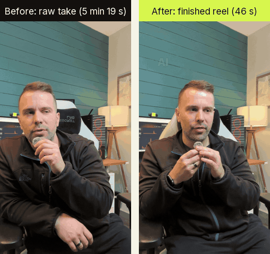
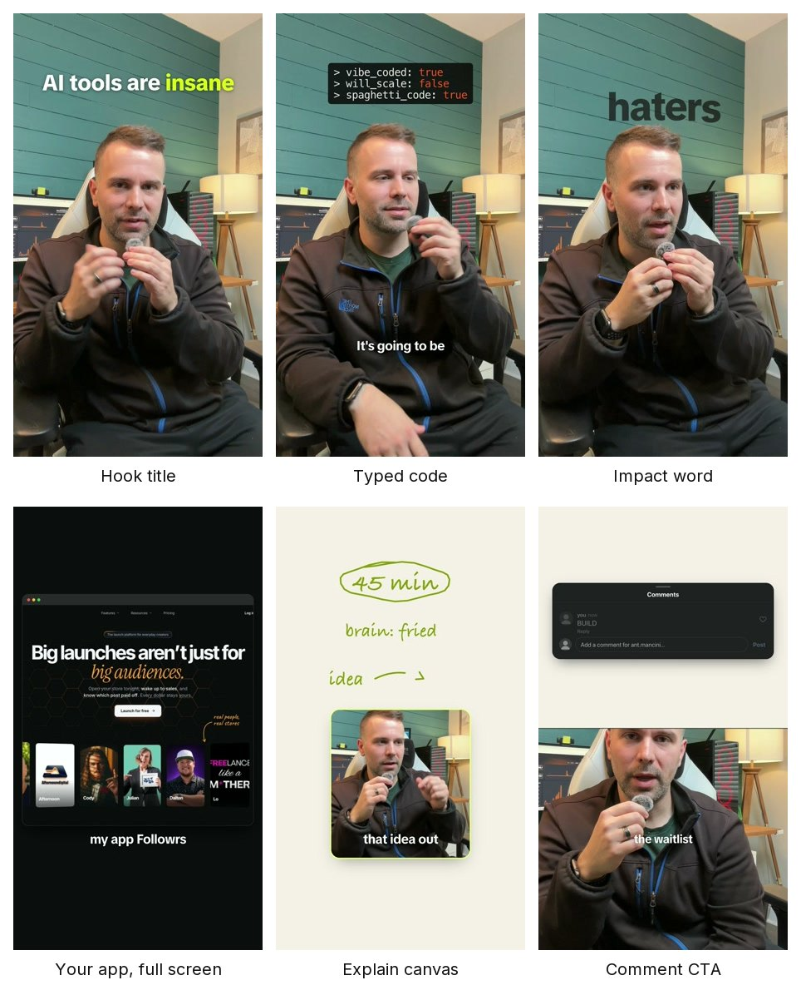
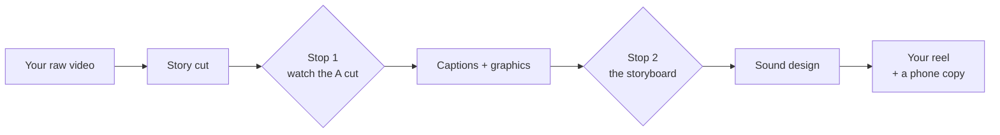
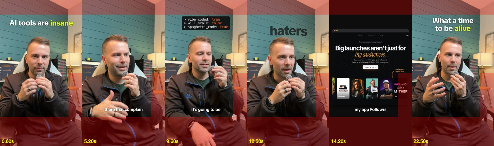

<div align="center">

# Storytelling Reel Editor

**Film yourself talking, retakes and all. Your AI agent turns it into a finished, ready-to-post reel, in your style.**

A free skill for **Claude Code** and **Codex** · made by [Ant Mancini](https://www.instagram.com/ant.mancini/)



<sub>Same moment, before and after. A 5-minute raw take with retakes became a 46-second reel.</sub>

</div>

---

## Install (one prompt)

Open the Claude desktop app and click the **Code** tab (or open Codex). Paste this, drag your video in right after it,
and press Enter:

> Set up the storytelling-reel-editor skill from https://github.com/anmancini90/storytelling-reel-editor (follow the README's "Agent setup"), then use it to edit this video:

Click **Allow** when it asks to run something. If it says Homebrew is missing, install it from https://brew.sh and
paste the prompt again. To update later, paste the same prompt: your styles, videos and sounds are never touched.

## What you get

| | |
|---|---|
| ✂️ **A tight story cut** | Your raw takes, mistakes and dead air go in. The best take of each line, in a tight order, comes out. You approve this "A cut" first. |
| 🎨 **Your style** | Send 3 to 5 reels you love. It breaks down their captions, pacing, graphics and sound, and builds *your* style from them. |
| 💬 **Captions and graphics on your words** | Hook titles, typed code, impact words, your app full screen, notifications, a "Comment X" box for your call to action. |
| 🔊 **Designed sound** | A whoosh on every move, a pop on every graphic, typing under typed text, a hit on the big line, from a sound kit you pick by ear. |
| 📱 **Nothing under the app buttons** | Every frame is checked against the TikTok and Reels button zones. |
| 🧠 **It learns your taste** | Say "make that the default" and every future edit starts from it. |

<div align="center">

<br><sub>Six moments from one finished reel.</sub>
</div>

## How an edit goes



Two stops where you decide; everything in between is automatic.

<div align="center">

<br><sub>Stop 2, the storyboard: a still at each graphic, checked before anything renders. Red bands mark the app's button zones.</sub>
</div>

### Your first edit

1. **Your Reels folder.** It asks where to keep your videos (outside iCloud, so big files don't go "offline"). You get an
   inbox, your style, and one folder per video. Videos from Downloads or your Desktop are copied, never moved.
2. **Build my style.** Send 3 to 5 reel links (Instagram, TikTok or YouTube) or files. A line on what you like about
   each helps. You approve a test still before it's saved.
3. **Stop 1, the A cut.** Watch the story cut. Ask for changes or say it's good.
4. **Stop 2, the storyboard.** See where every caption and graphic lands. Change anything.
5. **Your sound kit (first time only).** About 3 free Mixkit sounds for each kind of moment, played on your own video.
   It asks before downloading anything. Keep the ones you like.
6. **Your reel.** A full-quality file to post, a lighter copy for your phone, and every version kept (`-v1`, `-v2`...).

After that, just ask:

> Edit the video in my inbox.

> When I say "my app", show a screenshot of my homepage (~/Desktop/home.png) full screen.

> Add a comment box for my CTA "Comment GUIDE", my handle is @yourhandle.

Then give feedback like you would to an editor: "the captions a touch bigger", "that whoosh comes in late", "make that
the default".

## Designed sound

| Moment on screen | Sound |
|---|---|
| A cutaway or a screen sliding in | whoosh (lands as the picture lands) |
| A title, card or pill popping in | pop |
| The big line | hit |
| Text typing out | keyboard typing |
| A tap, a check, a button | click / tap |
| A drawn line or circle | pen scribble |
| A build-up | riser |

Sounds come from your own kit, levelled against your voice, and nothing sits on top of a word. Add music inside
Instagram or TikTok when you post: it's licensed there, and trending sounds help reach.

## What you need

| | |
|---|---|
| **Agent** | Claude Code (the Code tab in the Claude desktop app, or the `claude` terminal app; paid Claude plan) **or** Codex. Have both? One install works in both. |
| **Computer** | A Mac (Apple Silicon is fastest). Linux and Windows aren't supported yet. |
| **Apps** | Google Chrome, ffmpeg, Node.js, Python 3. Setup names anything missing with the one-line command to install it. |
| **Space** | About 3 GB (the editing tools and the speech-to-text model download once). |

## Tips

- Film vertical (9:16). Retakes and mistakes are fine: the story cut takes care of them.
- iPhone HDR footage: export as SDR first (Photos: Share → Options → Most Compatible).
- Write any on-screen joke text exactly how you want it shown. It's used word for word.

## Resources

| | |
|---|---|
| [**Cap**](https://cap.so) | Free screen recorder. Record your app or site and the skill can show it in your reel. |
| [**Mixkit free sound effects**](https://mixkit.co/free-sound-effects/) | Where your sound kit comes from, free to use in your videos. The skill downloads only the sounds you OK; none ship with it. |
| [**Epidemic Sound**](https://www.epidemicsound.com) | Optional, paid. Download a sound from your own account (you sign in, never the agent) and say "add this to my sound kit as a whoosh". |
| **Reference reels** | Your Instagram Saved, TikTok Favorites, or YouTube Shorts you've liked. Pick reels you'd love yours to look and sound like. |

## FAQ

<details><summary><b>Does my footage get uploaded anywhere?</b></summary>

No. Everything runs on your Mac. Your videos never leave it.
</details>

<details><summary><b>How do I update?</b></summary>

Paste the install prompt again. Your styles, videos and sound kit live in your Reels folder and are never touched.
</details>

<details><summary><b>It says Homebrew (or ffmpeg, Node.js, Chrome) is missing.</b></summary>

Install what it names with the command it gives (Homebrew from https://brew.sh), then paste the prompt again.
</details>

<details><summary><b>Can I use the reels commercially?</b></summary>

Yes, your reels are yours. See [LICENSE.md](LICENSE.md) for the skill itself and the third-party parts.
</details>

## Agent setup

For the AI agent doing the install. Run this block as it is, then read the installed `SKILL.md` and follow it.

```bash
REPO_URL=https://github.com/anmancini90/storytelling-reel-editor.git
ZIP_URL=https://github.com/anmancini90/storytelling-reel-editor/archive/refs/heads/main.zip
SRC="${REEL_EDITOR_HOME:-$HOME/.reel-editor}/source"
mkdir -p "$(dirname "$SRC")"
# Only use git when Apple's developer tools are installed (on a fresh Mac, plain `git` opens an install popup).
if xcode-select -p >/dev/null 2>&1 && [ -d "$SRC/.git" ]; then
  git -C "$SRC" fetch -q origin && git -C "$SRC" reset -q --hard origin/main
else
  rm -rf "$SRC"
  if xcode-select -p >/dev/null 2>&1; then
    git clone -q "$REPO_URL" "$SRC"
  else
    TMP="$(mktemp -d)"
    curl -fsSL "$ZIP_URL" -o "$TMP/main.zip" && unzip -q "$TMP/main.zip" -d "$TMP" \
      && mv "$TMP/storytelling-reel-editor-main" "$SRC"; rm -rf "$TMP"
  fi
fi
if [ -f "$SRC/skill/SKILL.md" ]; then bash "$SRC/skill/scripts/install.sh"; else echo "DOWNLOAD FAILED: $SRC/skill is missing"; fi
```

What it does: keeps a copy of this repo in `~/.reel-editor/source` (updated in place when run again), then
`skill/scripts/install.sh` copies the skill into Claude's skills folder (`${CLAUDE_CONFIG_DIR:-~/.claude}/skills`),
links it for Codex when Codex is installed (one copy for both apps), and runs setup, which names anything missing
(ffmpeg, Node.js, Chrome, Python) with the command to install it. An older version never replaces a newer install.

## What's inside

| Path | |
|---|---|
| `skill/SKILL.md` | The instructions your agent follows. |
| `skill/reference/` | The why behind every rule: story cut, style builder, graphics, audio and sound design. |
| `skill/scripts/` | Install, setup, story cut, transcription, captions, rendering, safe-area check, sound kit, mix, export. |
| `skill/template/` | The animation page your graphics are built in. |
| `skill/fonts/` | TikTok Sans, Inter and Hanken Grotesk (free, open licence). |

Your own style lives in your Reels folder (`01_Styles/my-style/`), so an update never loses it.

---

<div align="center">

Made by **Ant Mancini** · [Instagram @ant.mancini](https://www.instagram.com/ant.mancini/) · [License](LICENSE.md)

</div>
